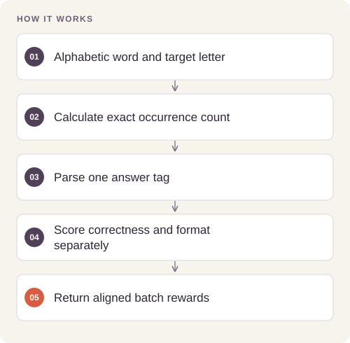

# LLM Counting Reward Design

Make character-counting rewards deterministic, testable, and separate from claims about language-model generalization.

## Implementation

Structured-answer parsing, exact counting targets, correctness and format rewards, and a completion-batch interface suitable for a training adapter.




## Inspect the original GPU training path

The complete original code-cell workflow is restored with source provenance and an explicit CUDA preflight. Its five-step then80-step phases continue the same adapter; they are not independent experiments.

[Commands, artifacts and benchmark scope](BENCHMARKS.md) · [Versioned profiles](reproduction.json)


## Try a small example

A small offline fixture exercises the public implementation. It demonstrates the behavior shown below; it does not replace the historical dataset, benchmark or production validation.

After the local setup below, run from the repository root:

```sh
python examples/quickstart.py
```

The [example source](examples/quickstart.py), [captured output](examples/expected-output.txt) and [execution record](examples/environment.json) keep this demonstration inspectable. Floating-point values may vary with library versions.

Observed output from this run:

```text
{'expected': 3, 'parsed_answer': 3, 'correctness_reward': 2.0, 'format_reward': 1.0}
[3.0]
```

## Evidence and results

The saved GRPO experiment uses Qwen2.5-3B-Instruct with LoRA rank 64 and 401 training examples. Across the 80-step main run, mean correctness reward rises from 1.23125 over the first ten steps to 1.53125 over the final ten. This is training reward, not held-out accuracy.

This public edition contains a standalone refactor and focused tests. Saved experimental outcomes and the current component checks have separate scopes; the refactor has not been used to recertify the original benchmark.

## Run the checks

Python 3.11 or later.

```sh
python -m venv .venv
source .venv/bin/activate
python -m pip install -r requirements.txt
python smoke_test.py
```

See [DATA.md](DATA.md) for input contracts and [VALIDATION.md](VALIDATION.md) for the verification scope. 

## Practical relevance and limitations

The saved comparison contains only one counting example and one retained-fact prompt; it does not establish general reasoning or knowledge retention. The standalone rewards are newly refactored and have not been used to recertify the original training trace.

No client deployment, commercial outcome, or new live-provider performance is inferred from the component tests.
