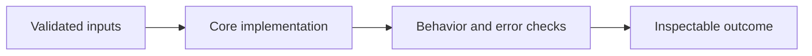

# LLM Counting Reward Design

**Feras Elghandour** · Technical case study

Make character-counting rewards deterministic, testable, and separate from claims about language-model generalization.

## Implementation

Structured-answer parsing, exact counting targets, correctness and format rewards, and a completion-batch interface suitable for a training adapter.



## Evidence and results

The saved GRPO experiment uses Qwen2.5-3B-Instruct with LoRA rank 64 and 401 training examples. Across the 80-step main run, mean correctness reward rises from 1.23125 over the first ten steps to 1.53125 over the final ten. This is training reward, not held-out accuracy.

This public edition contains a standalone refactor and focused tests. Saved experimental outcomes and the current component checks have separate scopes; the refactor has not been used to recertify the original benchmark.

## Run the checks

Python 3.11 or later.

```sh
python -m venv .venv
source .venv/bin/activate
python -m pip install -r requirements.txt
python smoke_test.py
```

See [DATA.md](DATA.md) for input contracts and [VALIDATION.md](VALIDATION.md) for the verification scope. The modules expose small APIs that can be integrated into a larger workflow.

## Practical relevance and limitations

The saved comparison contains only one counting example and one retained-fact prompt; it does not establish general reasoning or knowledge retention. The standalone rewards are newly refactored and have not been used to recertify the original training trace.

No client deployment, commercial outcome, or new live-provider performance is inferred from the component tests.
